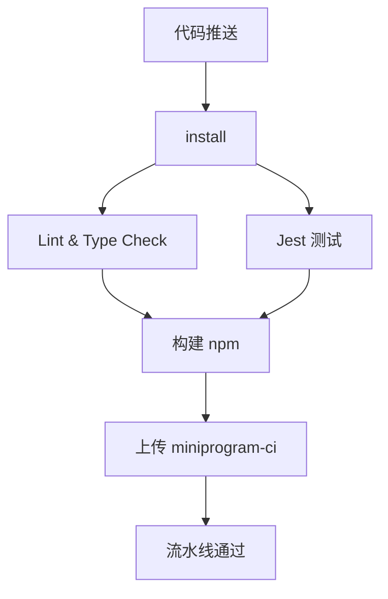

# 测试

## 测试奖杯

测试策略采用 [Kent C. Dodds](https://kentcdodds.com/blog/static-vs-unit-vs-integration-vs-e2e-tests) 提出的**测试奖杯（Testing Trophy）**模型：


底座是静态分析，往上依次是单元测试、集成测试和 E2E，层的面积代表投入比例——集成测试占大头：

| 层级 | 工具 | 投入 |
|------|------|------|
| 静态分析 | ESLint / stylelint / `tsc --noEmit` | 全量持续运行，配置详见 [Lint](../lint/) |
| 单元测试 | [Jest](https://jestjs.io/zh-Hans/) | 精选核心纯逻辑，不追求全覆盖 |
| 集成测试 | [miniprogram-simulate](https://github.com/wechat-miniprogram/miniprogram-simulate) | 主体投入 |
| E2E | [miniprogram-automator](https://developers.weixin.qq.com/miniprogram/dev/devtools/auto/) | 仅核心业务路径 |

测试数据可用 [Faker.js](https://fakerjs.dev/) 生成随机数据，避免手写固定值。

这套策略可以概括成两句话：

> 编写测试。不要太多。主要写集成测试。
> —— Guillermo Rauch

> 测试越接近软件的实际使用方式，能带来的信心就越多。
> —— Kent C. Dodds

越贴近真实用户，测试结果越可信，但执行越慢、维护越贵——E2E 信心最高也最贵，单元测试便宜但离用户远。集成测试在两者之间平衡，因此是投入重心。

## 静态分析

奖杯的底座不是测试，而是静态分析。它像拼写检查：不运行程序就能拦住拼写、语法、类型和风格问题——这类低级缺陷占比不低，拦截成本却几乎为零。

落到三处：编辑器实时校验（ESLint / stylelint / TypeScript 插件）、提交时 lint-staged 拦截、CI 全局扫描。

小程序特有的全局变量声明、WXSS 规则等配置，详见 [Lint](../lint/)。

## 单元测试

不必为了覆盖率把每个函数都测一遍。值得写单元测试的是逻辑复杂、边界条件多、与 UI 无关的纯函数——金额计算、加解密、脱敏、格式化这类。与 UI 有关的交给组件测试。

```ts
// services/crypto/mask.ts
export const maskPhone = (phone: string): string => {
  if (!phone || phone.length !== 11) return phone;
  return phone.replace(/(\d{3})\d{4}(\d{4})/, '$1****$2');
};
```

```ts
// __tests__/services/crypto/mask.test.ts
import { maskPhone } from '@/services/crypto/mask';

describe('maskPhone', () => {
  it('应正确脱敏 11 位手机号', () => {
    expect(maskPhone('13800138000')).toBe('138****8000');
  });

  it('非 11 位手机号原样返回', () => {
    expect(maskPhone('1380013800')).toBe('1380013800');
    expect(maskPhone('')).toBe('');
  });
});
```

## 集成测试

集成测试让多个模块真实协作，只在系统边界——`wx.*` API 和网络请求——处 mock。项目里有两种形态：

- **组件测试**：用 miniprogram-simulate 渲染组件，验证渲染输出、properties、事件
- **services 流程测试**：mock 掉 `wx.login`、`wx.request` 等边界，验证登录这类跨模块流程

### 组件测试（miniprogram-simulate）

[miniprogram-simulate](https://github.com/wechat-miniprogram/miniprogram-simulate) 是微信官方的组件测试工具，在 Node 里用 jsdom 模拟组件的渲染、生命周期和事件，不需要启动开发者工具。

它擅长：

- 自定义组件的渲染输出（DOM 树、data 字段）
- properties 变化后的响应
- 组件方法与 `triggerEvent` 事件传递
- CI 中的组件级回归

不擅长——这些交给 [E2E 测试](#e2e-测试miniprogram-automator)：

- `wx.*` API 的真实行为（真实网络请求、真实存储）
- 页面跳转、tabBar 等页面级交互
- 真机性能

#### 配置

```bash
npm install -D miniprogram-simulate jest jsdom
```

```js
// jest.config.js
module.exports = {
  testEnvironment: 'jsdom',
  testMatch: ['**/__tests__/**/*.test.ts'],
  moduleNameMapper: {
    '^@/(.*)$': '<rootDir>/src/$1',
  },
  transform: {
    '^.+\\.ts$': 'ts-jest',
  },
  setupFiles: ['<rootDir>/jest.setup.js'],
};
```

```js
// jest.setup.js
// 模拟小程序全局 API（按需补充）
global.wx = {
  // 大多数组件测试不需要 wx API，按用例补充
};
```

工作原理：`simulate.load()` 加载组件返回 componentId，`simulate.render()` 渲染返回实例，实例上有 `data`、`instance`（组件 this）和 `querySelector`（子节点）。注意它不会真的调用 `wx.*`——依赖 `wx.showToast` 之类的用例要自己 mock。

#### 基础示例

被测组件：

```ts
// src/components/counter/counter.ts
Component({
  data: { count: 0 },
  methods: {
    onIncrement() {
      this.setData({ count: this.data.count + 1 });
    },
  },
});
```

测试用例：

```ts
// __tests__/components/counter.test.ts
const simulate = require('miniprogram-simulate');
const path = require('path');

describe('counter 组件', () => {
  let componentId: string;

  beforeAll(() => {
    componentId = simulate.load(path.resolve(__dirname, '../../src/components/counter/counter'));
  });

  it('初始 count 应为 0', () => {
    const comp = simulate.render(componentId);
    comp.attach(document.body);
    expect(comp.data.count).toBe(0);
  });

  it('点击后 count 应 +1', () => {
    const comp = simulate.render(componentId);
    comp.attach(document.body);

    comp.instance.onIncrement();
    expect(comp.data.count).toBe(1);
  });
});
```

#### properties 与事件

被测组件：

```ts
// src/components/stepper/stepper.ts
Component({
  properties: {
    min: { type: Number, value: 0 },
    max: { type: Number, value: 10 },
    value: { type: Number, value: 0 },
  },
  methods: {
    onDec() {
      const next = Math.max(this.properties.min, this.properties.value - 1);
      this.setData({ value: next });
      this.triggerEvent('change', { value: next });
    },
  },
});
```

测试用例：

```ts
describe('stepper 组件', () => {
  let id: string;
  beforeAll(() => {
    id = simulate.load(path.resolve(__dirname, '../../src/components/stepper/stepper'));
  });

  it('受 min 约束', () => {
    const comp = simulate.render(id, { min: 0, value: 0 });
    comp.attach(document.body);
    comp.instance.onDec();
    expect(comp.data.value).toBe(0);
  });

  it('change 事件携带新值', () => {
    const comp = simulate.render(id, { min: 0, max: 10, value: 5 });
    comp.attach(document.body);

    const onChange = jest.fn();
    comp.addEventListener('change', onChange);

    comp.instance.onDec();
    expect(onChange).toHaveBeenCalledWith(expect.objectContaining({
      detail: { value: 4 },
    }));
  });
});
```

#### Mock wx API

```js
// jest.setup.js
global.wx = {
  showToast: jest.fn(),
  showLoading: jest.fn(),
  hideLoading: jest.fn(),
};
```

```ts
// __tests__/components/feedback.test.ts
beforeEach(() => {
  jest.clearAllMocks();
});

it('提交成功应弹 toast', () => {
  const comp = simulate.render(id);
  comp.attach(document.body);

  comp.instance.onSubmitSuccess();
  expect(global.wx.showToast).toHaveBeenCalledWith(
    expect.objectContaining({ title: '提交成功' })
  );
});
```

### services 流程测试

登录这类流程 = `wx.login` + http 请求 + storage 写入，跨了多个模块。测试时让模块真实协作，只 mock `wx.*` 与网络请求两处边界：

```ts
// __tests__/services/auth/login.test.ts
import { login } from '@/services/auth/login';

// Mock wx.login
const mockWxLogin = jest.fn();
global.wx = {
  login: mockWxLogin,
  setStorageSync: jest.fn(),
  getStorageSync: jest.fn(),
};

describe('login', () => {
  beforeEach(() => {
    jest.clearAllMocks();
  });

  it('应正确处理登录流程', async () => {
    mockWxLogin.mockImplementation(({ success }) => {
      success({ code: 'test_code' });
    });

    // Mock request
    jest.mock('@/services/http', () => ({
      request: jest.fn().mockResolvedValue({
        token: 'test_token',
        refreshToken: 'test_refresh_token',
        isNewUser: false,
      }),
    }));

    const result = await login();

    expect(result.token).toBe('test_token');
    expect(global.wx.setStorageSync).toHaveBeenCalledWith(
      'auth_token',
      expect.objectContaining({ data: 'test_token' }),
    );
  });
});
```

## E2E 测试（miniprogram-automator）

[miniprogram-automator](https://developers.weixin.qq.com/miniprogram/dev/devtools/auto/) 是微信官方的 E2E 工具，从外部控制**微信开发者工具**，模拟点击、输入、滚动等真实用户操作，验证完整业务链路。它位于奖杯顶部：信心最高（100% 真实环境），成本也最高（秒级执行、要启动工具），所以只留给核心业务路径。

### 环境要求

- 已安装微信开发者工具
- 开发者工具 → 设置 → 安全设置 → 开启"服务端口"
- 操作系统：macOS / Windows（**Linux 不支持**，因开发者工具不支持）

### 基础示例

```ts
// e2e/login.test.ts
const automator = require('miniprogram-automator');

describe('登录流程 E2E', () => {
  let miniProgram: any;
  let page: any;

  beforeAll(async () => {
    miniProgram = await automator.launch({
      cliPath: '/Applications/wechatwebdevtools.app/Contents/MacOS/cli',  // macOS
      // Windows: 'C:\\Program Files (x86)\\Tencent\\微信web开发者工具\\cli.bat'
      projectPath: '/path/to/your/miniprogram',
    });
  });

  afterAll(async () => {
    await miniProgram.close();
  });

  beforeEach(async () => {
    page = await miniProgram.reLaunch('/pages/login/index');
    await page.waitFor(500);
  });

  it('点击登录按钮应跳转到首页', async () => {
    const loginBtn = await page.$('.login-btn');
    await loginBtn.tap();

    await page.waitFor(1000);
    const currentPage = await miniProgram.currentPage();
    expect(currentPage.path).toBe('pages/home/index');
  });
});
```

### 核心 API

| API | 作用 |
|-----|------|
| `automator.launch(opts)` | 启动开发者工具并连接，返回 miniProgram 实例 |
| `miniProgram.reLaunch(path)` | 跳转到指定页面 |
| `miniProgram.currentPage()` | 获取当前页面对象 |
| `miniProgram.callMethod(name, args)` | 调用页面方法（用于触发登录、提交等） |
| `miniProgram.mockWxMethod(name, fn)` | mock `wx.*` API（如 mock wx.request） |
| `page.$(selector)` / `page.$$(selector)` | 查找元素 / 元素列表 |
| `element.tap()` / `element.input(value)` | 模拟点击 / 输入 |
| `page.waitFor(ms)` / `page.waitFor(condition)` | 等待时间 / 条件 |
| `miniProgram.close()` | 关闭连接 |

### Mock 网络

E2E 通常 mock 掉 `wx.request`，避免依赖真实后端：

```ts
beforeAll(async () => {
  miniProgram = await automator.launch({ /* ... */ });

  // mock wx.request
  await miniProgram.mockWxMethod('request', (options, invokeCallback) => {
    if (options.url.includes('/api/auth/login')) {
      invokeCallback({
        statusCode: 200,
        data: { token: 'mock_token', refreshToken: 'mock_refresh' },
      });
    } else {
      invokeCallback({ statusCode: 404 });
    }
  });
});
```

这样可以在 E2E 里跑完整的登录 → 支付链路，而不依赖真实后端，保证测试稳定。

### 完整下单流程示例

```ts
describe('下单流程 E2E', () => {
  let miniProgram: any;

  beforeAll(async () => {
    miniProgram = await automator.launch({
      cliPath: process.env.WX_CLI_PATH,
      projectPath: process.env.WX_PROJECT_PATH,
    });

    // 预置登录态：mock wx.login + wx.request
    await miniProgram.mockWxMethod('login', (options, invokeCallback) => {
      invokeCallback({ code: 'mock_code' });
    });
    await miniProgram.mockWxMethod('request', (options, invokeCallback) => {
      // 按 URL 路由返回不同 mock 数据
      // ...
    });
  });

  it('从首页到下单成功全链路', async () => {
    await miniProgram.reLaunch('/pages/home/index');

    // 1. 点击第一个商品
    const item = await miniProgram.$('.goods-item');
    await item.tap();

    // 2. 详情页加入购物车
    await miniProgram.waitFor(800);
    const addBtn = await miniProgram.$('.add-to-cart');
    await addBtn.tap();

    // 3. 跳到购物车
    await miniProgram.navigateTo({ url: '/pages/cart/index' });
    await miniProgram.waitFor(500);

    // 4. 结算
    const checkoutBtn = await miniProgram.$('.checkout-btn');
    await checkoutBtn.tap();

    // 5. 验证跳转到订单页
    await miniProgram.waitFor(1500);
    const current = await miniProgram.currentPage();
    expect(current.path).toBe('pages/order/index');
  });

  afterAll(async () => {
    await miniProgram.close();
  });
});
```

### 适用场景与限制

E2E 适合保护核心路径（登录、下单、支付）的回归，替代重复的人工冒烟；频繁改动但风险高的页面也值得覆盖。不适合承载大量细节断言——那是组件测试的事，又快又稳；CI 时长紧张时也不宜全量铺开。

限制需要心里有数：

- 启动慢，每次启动开发者工具加编译要数秒到数十秒
- 用例间状态隔离要自己做（每次测试前 `reLaunch` 重置）
- 不支持 Linux
- 开发者工具版本与 SDK 兼容性偶有抖动，需固定版本

## 提交管控

本地提交由 Husky + lint-staged 卡点：暂存区代码过 ESLint 检查，通过后才允许生成 commit。

```js
// lint-staged.config.js
module.exports = {
  '*.{js,ts}': ['eslint --fix'],
};
```

## CI 集成



完整流水线定义见 [CI/CD](../ci/)，本文档只展开与测试相关的两个 job。

### 单元测试 + 集成测试

Jest 一次性跑完单元测试、组件测试和 services 流程测试，并上报覆盖率：

```yaml
# .gitlab-ci.yml（测试部分）
test:
  stage: test
  image: node:lts
  needs: [install]
  script:
    - npm run test
  coverage: '/Lines\s*:\s*(\d+\.\d+)%/'
  artifacts:
    reports:
      coverage_report:
        coverage_format: cobertura
        path: coverage/cobertura-coverage.xml
```

### E2E 测试

:::warning
E2E 依赖微信开发者工具，Runner 必须是 macOS / Windows 自托管机器；GitLab 共享 Runner 仅支持 Linux，跑不了 E2E。
:::

E2E 成本高，在 MR 流水线中手动触发：

```yaml
# .gitlab-ci.yml（E2E 部分）
e2e:
  stage: test
  tags:
    - macos               # 自托管 macOS / Windows Runner
  needs: [install]
  rules:
    - if: $CI_PIPELINE_SOURCE == "merge_request_event"
      when: manual        # 手动触发
  variables:
    WX_CLI_PATH: /Applications/wechatwebdevtools.app/Contents/MacOS/cli
    WX_PROJECT_PATH: $CI_PROJECT_DIR
  script:
    - brew install --cask wechatwebdevtools
    # 启动开发者工具并打开服务端口
    - /Applications/wechatwebdevtools.app/Contents/MacOS/cli open --project $CI_PROJECT_DIR
    - sleep 30            # 等待工具启动
    - npm run test:e2e
```

### 质量门禁

ESLint、`tsc --noEmit` 与 Jest 并行执行，覆盖率低于阈值（如 70%）时流水线阻断。

## 策略与权衡

100% 覆盖率不是目标。覆盖率用于发现长期没有测试的高风险区域，为凑数写的断言没有价值。

过度隔离的单元测试和实现细节耦合，重构时要跟着改，慢慢就没人维护了。这正是把重心放在集成测试上的原因——渲染、交互、事件都按真实使用的方式验证，重构内部实现时不容易失效。

流水线时间过长时，先检查是否把本该由组件测试承担的断言写进了 E2E。项目重度 UI、业务逻辑简单的话，把资源向 E2E 倾斜也是合理选择。

## 覆盖率配置

阈值是质量下限，不是冲刺目标；未达标时优先补集成测试。

```js
// jest.config.js
module.exports = {
  collectCoverage: true,
  coverageDirectory: 'coverage',
  coverageReporters: ['text', 'lcov', 'cobertura'],
  coverageThreshold: {
    global: {
      branches: 70,
      functions: 70,
      lines: 70,
      statements: 70,
    },
  },
  collectCoverageFrom: [
    'src/**/*.ts',
    '!src/**/*.d.ts',
    '!src/miniprogram_npm/**',
  ],
};
```

## 参考资料

- [测试策略（web.dev）](https://web.dev/articles/ta-strategies?hl=zh-cn)
- [Static vs Unit vs Integration vs E2E Tests — Kent C. Dodds](https://kentcdodds.com/blog/static-vs-unit-vs-integration-vs-e2e-tests)
- [miniprogram-simulate](https://github.com/wechat-miniprogram/miniprogram-simulate)
- [miniprogram-automator](https://developers.weixin.qq.com/miniprogram/dev/devtools/auto/)
- [Jest](https://jestjs.io/zh-Hans/)
- [小程序自动化测试](https://developers.weixin.qq.com/miniprogram/dev/framework/custom-component/unit-test.html)
